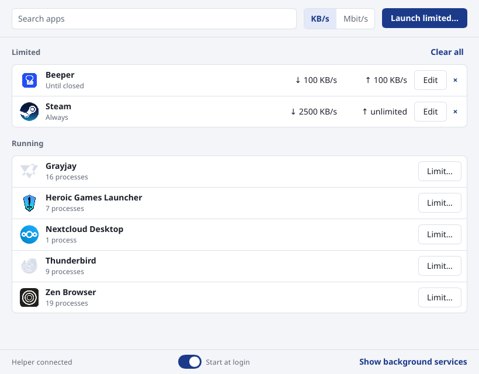
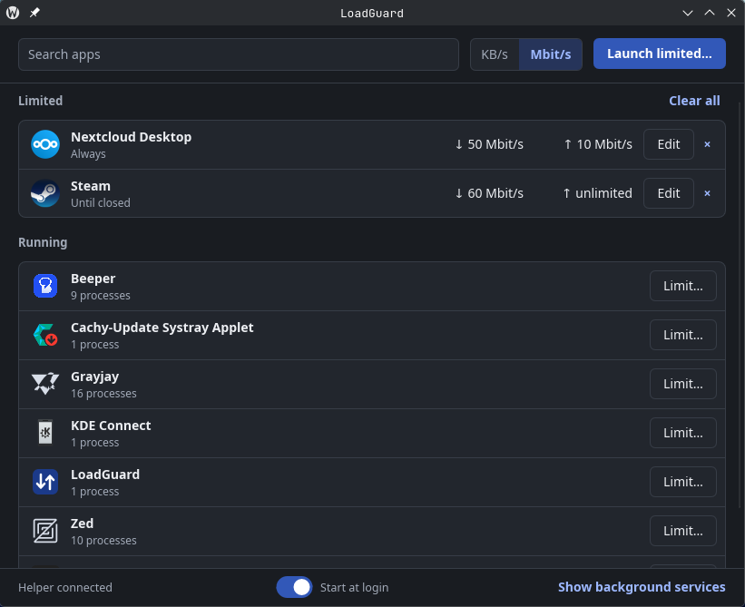
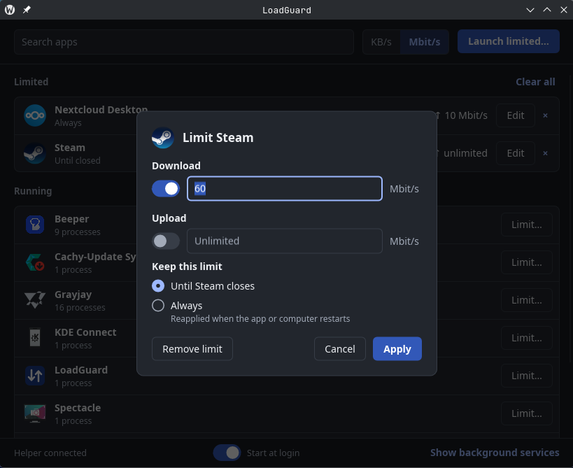

<p align="center">
  
</p>

<h1 align="center">LoadGuard</h1>

<p align="center">
  
  
  
  <a href="LICENSE"></a>
</p>

LoadGuard lets you choose how much of your internet connection each app may use.
Stop a big download or a game update from slowing everything else down: give it a
speed limit and keep browsing, calling or streaming in peace.

Pick a running app, set a download or upload speed, and that's it. The limit can
last until the app closes, or stay in place every time you use it. You can also
start an app with a limit from the beginning. LoadGuard sits quietly in your system
tray, and your limits keep working even when its window is closed.

## Screenshots

| Light | Dark |
| --- | --- |
|  |  |



## How it works

Desktops like KDE Plasma and GNOME start each app in its own systemd **cgroup**.
LoadGuard finds apps through these groups, so it can limit an app that is already
running, along with every process it starts. Apps that split themselves across
several groups, as Chromium and Electron apps do, are recognised and share one limit.

Limits are enforced by the kernel with **nftables** rules matching each app's
cgroup. This works for any program and protocol (TCP and UDP), and is not tied to a
particular network interface. Traffic over the limit is dropped, so speeds settle just
under the cap after a short initial burst.

Changing firewall rules needs root, so a small system service (`loadguard-helper`)
does it on behalf of the desktop apps:

- It accepts only an app name and speeds over D-Bus, never rules or paths, and
  only ever touches the calling user's apps.
- Changes are authorised through **polkit**: you enter your password once per login.
- It runs sandboxed by systemd, with nothing but the network admin capability.
- It reapplies saved limits at boot, follows apps when they restart, and restores
  its rules if another program removes them.

The window and the command line are ordinary user programs that talk to this service.

## Command line

```sh
loadguard list                                   # running apps and their limits
loadguard limit firefox --down 500K --up 100K    # until Firefox closes
loadguard limit steam --down 20Mbit --always     # also after restarts
loadguard run --down 500K -- wget https://example.org/file.iso
loadguard clear firefox                          # or: loadguard clear --all
```

- Apps can be named by any unambiguous part of their name.
- Speeds are in KB/s (1000 bytes) unless a unit is given: `B`, `KB`, `MB`, `GB`,
  `kbit`, `Mbit` or `Gbit`. Use `none` to lift one direction: `--up none`.
- `run` starts a program with the limit in place before its first byte. It runs
  without a shell, so pipes and variables are not interpreted.

## Requirements

- Linux with systemd and cgroup v2, which almost every current distribution uses.
  `run` and launching from the window need systemd 254 or newer.
- nftables and polkit.
- A desktop that starts apps in their own cgroup, such as KDE Plasma or GNOME.
  On others, start apps through LoadGuard to limit them.
- For the tray icon, a panel that shows StatusNotifier icons. KDE Plasma does;
  GNOME needs the AppIndicator extension.

## Install

### Arch Linux

```sh
git clone https://github.com/Keaexe/LoadGuard.git
cd LoadGuard/packaging/arch
makepkg -si
sudo systemctl enable --now loadguard   # reapplies saved limits at boot
```

Then open **LoadGuard** from your app menu, or run `loadguard-gui`.

Packages for other distributions are planned.

### Uninstall

```sh
sudo systemctl disable --now loadguard  # removes every limit
sudo pacman -R loadguard-local
```

Saved limits stay in `/var/lib/loadguard` until you delete that folder.

## Build from source

You need a recent stable Rust (LoadGuard is developed with 1.98), plus the fontconfig, freetype and libxkbcommon
development files for the window.

```sh
cargo build --release
```

This builds three programs in `target/release`: `loadguard` (command line),
`loadguard-gui` (window and tray) and `loadguard-helper` (the system service).
The helper only works once installed with the files in `packaging/`, which
`packaging/arch/PKGBUILD` shows how to place.

## Development

```sh
cargo test                     # unit tests
scripts/test-limits.sh         # generated rules, measured in an isolated namespace
scripts/test-helper.sh         # helper and command line end to end, no root needed
scripts/test-gui.sh            # real window, tray and single instance on a virtual display
cargo run -p loadguard-gui --example screens -- DIR   # GUI checks and screenshots
```

None of these need root or touch your real network or limits. `test-gui.sh`
needs `kwin_wayland`.

| Crate | Contents |
| --- | --- |
| `loadguard-core` | App discovery, rates, rules, launching and the D-Bus client |
| `loadguard-helper` | The privileged system service |
| `loadguard-cli` | The `loadguard` command |
| `loadguard-gui` | The Slint window and tray |

## License

LoadGuard is free software under the [GNU General Public License v3.0](LICENSE).
